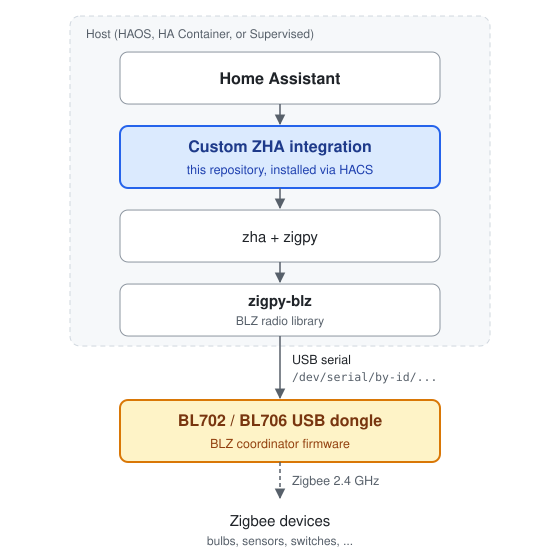

# ZHA BLZ Installation Guide

This is a custom ZHA integration for Home Assistant that adds support for Bouffalo Lab **BLZ** Zigbee radios (BL702/BL706), including the [ThirdReality Zigbee 3.0 USB Dongle](https://github.com/thirdreality/ThirdReality-Zigbee-3.0-USB-dongle).

It is a drop-in replacement for the built-in ZHA -- all standard ZHA features and devices continue to work. The only addition is the BLZ radio type powered by the [zigpy-blz](https://github.com/bouffalolab/zigpy-blz) library.

<p align="center">
  
</p>

## How it works

<p align="center">
  
</p>

This repository replaces only the ZHA integration layer. zigpy-blz talks to the dongle over USB serial; when ZHA asks for the serial port, pick the dongle's `/dev/serial/by-id/...` path.

## Repository

- Source: [bouffalolab/haos\_custom\_zha\_blz](https://github.com/bouffalolab/haos_custom_zha_blz)

---

## Option 1: Install via HACS (recommended for HAOS)

### Prerequisites

- Home Assistant OS or Supervised with [HACS](https://hacs.xyz/) installed

### Steps

1. In Home Assistant, go to **HACS** > **Integrations**.
2. Click the three-dot menu (top right) > **Custom repositories**.
3. Add the following URL with category **Integration**:

       https://github.com/bouffalolab/haos_custom_zha_blz
4. Search for **ZHA with BLZ Radio Support** and click **Install**.
5. Restart Home Assistant.
6. Go to **Settings** > **Devices & Services** > **Add Integration**.
7. Select **Zigbee Home Automation**.
8. Choose **BLZ = Bouffalo Lab Zigbee radios: BL702/4/6**.
9. Set the serial port (e.g. `/dev/ttyUSB0`) and baud rate `2000000`.

---

## Option 2: Home Assistant Container (Docker)

For users running Home Assistant in Docker. All commands run on **the Docker host**. HA will automatically install the required Python dependencies on restart.

### Steps

```bash
# 1. Find your HA config path on the host
HA_CONFIG=$(docker inspect homeassistant \
  -f '{{ range .Mounts }}{{ if eq .Destination
    "/config" }}{{ .Source }}{{ end }}{{ end }}')
echo "HA config path: $HA_CONFIG"

# 2. Clone the component and copy it in
git clone --depth 1 \
  https://github.com/bouffalolab/haos_custom_zha_blz.git
mkdir -p "$HA_CONFIG/custom_components"
cp -r haos_custom_zha_blz/custom_components/zha \
  "$HA_CONFIG/custom_components/"
rm -rf haos_custom_zha_blz

# 3. Restart Home Assistant
docker restart homeassistant
```

4. Open the HA web interface at `http://<your-host>:8123`.
5. Follow steps 6-9 from Option 1 to configure the BLZ radio.

> The `custom_components/zha/` folder lives in your config volume and
> persists across container upgrades. HA reads the component's
> `manifest.json` and installs `zigpy-blz` and `zha@feat/blz`
> automatically on each startup.

---

## Option 3: Manual install via SSH (HAOS without HACS)

For HAOS users who prefer not to use HACS.

### Prerequisites

1. Home Assistant OS with **Advanced Mode** enabled.
2. Terminal & SSH app (or another SSH method) installed and started.

### Steps

```bash
# 1. SSH into Home Assistant
ssh -p 22 <user>@<HA_IP>

# 2. Clone the repository and copy the component
mkdir -p /config/custom_components && cd /config
git clone --depth 1 \
  https://github.com/bouffalolab/haos_custom_zha_blz.git
cp -r haos_custom_zha_blz/custom_components/zha \
  custom_components/
rm -rf haos_custom_zha_blz

# 3. Restart Home Assistant
ha core restart
```

Then follow steps 6-9 from Option 1 to configure the BLZ radio.


---

**Note:** HA Core (Python venv) was deprecated in HA 2025.12. If you are still on Core, the Option 2 steps apply -- copy `custom_components/zha/` into your config directory and HA will install the dependencies automatically.
